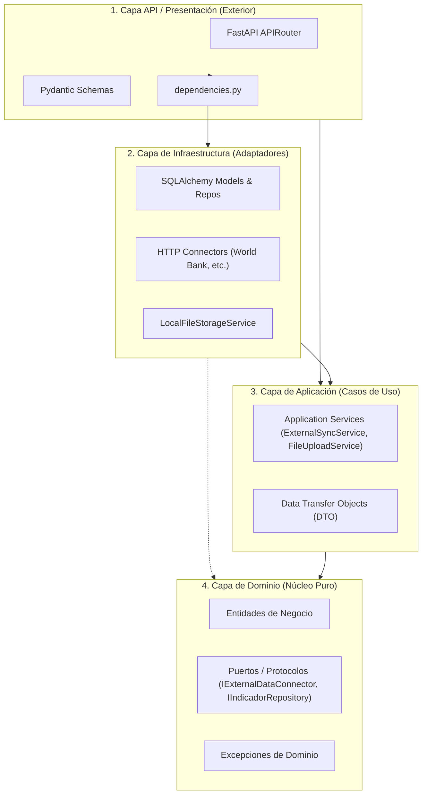

# Arquitectura de Capas y Principios de Diseño (`backend`)

> **Propósito:** Definir el modelo arquitectónico de **Clean Architecture** (Arquitectura Limpia) y directrices **SOLID** implementadas en el backend de `obspred`, estableciendo la regla de dependencias unidireccional y las responsabilidades de cada módulo.

---

## 1. La Regla de Dependencia

El principio rector de la arquitectura es: **las dependencias del código solo pueden apuntar hacia adentro**. 

- Los círculos/capas interiores no saben nada de los círculos exteriores.
- Ningún elemento de **Dominio** o **Aplicación** debe importar ni conocer frameworks web (FastAPI), librerías de persistencia (SQLAlchemy), ni clientes HTTP externos (HTTPX).



---

## 2. Responsabilidad Detallada de Cada Capa

### A. Capa de Dominio (`app/domain/`) — *El Núcleo*
Contiene la lógica y las reglas de negocio esenciales e inmutables del Observatorio.
- **`entities/`:** Modelos de negocio puros (atributos y reglas que no dependen de base de datos).
- **`interfaces/` (Puertos):** Interfaces abstractas o `Protocol` que definen contratos obligatorios para cualquier tecnología externa:
  - `IIndicadorRepository`: Operaciones requeridas de almacenamiento (`upsert_batch`, `get_filtered`).
  - `IExternalDataConnector`: Protocolo para ingesta de APIs externas (`fetch_indicators`, `health_check`).
  - `IFileStorageService`: Protocolo de persistencia de archivos físicos.
  - `IFileValidator`: Protocolo de validación de estructura de datasets.
- **`exceptions/`:** Jerarquía de excepciones de negocio (`DomainException`, `EntityNotFoundException`). No contienen códigos de estado HTTP ni lógica web.

### B. Capa de Aplicación (`app/application/`) — *Los Casos de Uso*
Orquesta el flujo de información entre el dominio y los puertos.
- **`services/`:** Contiene los casos de uso específicos del sistema:
  - `ExternalSyncService`: Coordina la extracción desde un conector y la persistencia en el repositorio.
  - `FileUploadService`: Valida y almacena archivos CSV en el sistema.
  - `IndiceEmpleabilidadService`: Calcula el índice multidimensional y desglosa sus 4 dimensiones.
- **`dtos/`:** Objetos inmutables de transferencia de datos entre capas internas (ej. `ExternalSyncResultDTO`, `FileUploadDTO`).

### C. Capa de Infraestructura (`app/infrastructure/`) — *Los Adaptadores*
Implementa los puertos definidos en el dominio utilizando herramientas tecnológicas concretas:
- **`connectors/`:** Adaptadores HTTP (`httpx`, `asyncio.gather`) para consumir APIs oficiales remotas (ej. `WorldBankConnector`).
- **`persistence/`:** 
  - `models/`: Modelos ORM de SQLAlchemy mapeados a tablas SQL (`IndicadorModel`).
  - `repositories/`: Implementaciones concretas de repositorios (`SqlAlchemyIndicadorRepository`).
  - `database.py`: Motor de base de datos asíncrono y generador de sesiones (`AsyncSession`).
- **`storage/`:** Adaptadores de almacenamiento físico en disco (`LocalFileStorageService`).

### D. Capa de API / Presentación (`app/api/`) — *El Front-facing*
Punto de entrada HTTP expuesto a través de FastAPI:
- **`v1/endpoints/`:** Controladores que reciben requests HTTP, validan parámetros de entrada, invocan dependencias inyectadas y devuelven respuestas.
- **`v1/schemas/`:** Esquemas Pydantic que validan solicitudes entrantes y serializan las respuestas salientes bajo el estándar `ApiResponse[T]`.
### E. Distinción Clave: `Entity` vs `DTO` vs `Schema` vs `Model`

Para mantener la pureza de cada capa y el desacoplamiento, el proyecto utiliza cuatro modelos de datos con responsabilidades claramente delimitadas:

```
  [ Cliente HTTP / Frontend ]
               │
               │ (JSON / Query Params)
               ▼
  ┌────────────────────────┐
  │      Capa API          │ ──► SCHEMAS (Pydantic BaseModel)
  │                        │     • Validación sintáctica y de formato HTTP.
  │                        │     • Serialización de salida (ApiResponse[T]).
  │                        │     • Generación automática de contratos OpenAPI / Swagger.
  └────────────────────────┘
               │
               │ (Objetos de transporte internos)
               ▼
  ┌────────────────────────┐
  │   Capa de Aplicación   │ ──► DTOs (Data Transfer Objects con @dataclass)
  │                        │     • Desacoplan la lógica de aplicación del framework web.
  │                        │     • Empaquetan inputs/outputs entre servicios y casos de uso.
  │                        │     • Sin dependencias de FastAPI ni de librerías ORM.
  └────────────────────────┘
               │
               │ (Reglas e invariantes puras)
               ▼
  ┌────────────────────────┐
  │    Capa de Dominio     │ ──► ENTITIES (@dataclass o clases de dominio)
  │                        │     • Núcleo del negocio con reglas e invariantes inmutables.
  │                        │     • Totalmente agnósticas de la tecnología y base de datos.
  │                        │     • No conocen Pydantic, SQLAlchemy ni HTTP.
  └────────────────────────┘
               ▲
               │ (Mapeo desde/hacia la base de datos)
  ┌────────────────────────┐
  │ Capa de Infraestructura│ ──► ORM MODELS (SQLAlchemy Base / Mapped)
  │                        │     • Definición de tablas, columnas, claves foráneas e índices.
  │                        │     • Exclusivos del repositorio de persistencia.
  └────────────────────────┘
```

| Concepto | Capa | Tecnología | Responsabilidad Principal | ¿Qué protege? |
|---|---|---|---|---|
| **`Schema`** | API / Presentación | Pydantic (`BaseModel`) | Validación de payloads entrantes, sanitización de queries y serialización JSON. | El contrato externo de la API y la documentación pública. |
| **`DTO`** | Aplicación | Python `@dataclass(frozen=True)` | Transportar información entre casos de uso, repositorios y controladores. | Desacopla la lógica interna del protocolo de transporte (HTTP, CLI, etc.). |
| **`Entity`** | Dominio | Python `@dataclass` o clase pura | Modelar el concepto de negocio y velar por sus reglas e invariantes. | La lógica y consistencia de negocio frente a cambios de librerías o DB. |
| **`ORM Model`** | Infraestructura | SQLAlchemy `Mapped[...]` | Mapeo objeto-relacional contra las tablas de PostgreSQL / SQLite. | La estructura física de almacenamiento y las consultas SQL. |

---

## 3. ¿Dónde debe vivir mi código nuevo? (Guía de Decisión)

| Si necesitas... | Pertenece a... | Ubicación |
|---|---|---|
| Definir un concepto de negocio con reglas e invariantes | **Domain (Entities)** | `app/domain/entities/` |
| Definir un nuevo contrato de repositorio o conector | **Domain (Interfaces)** | `app/domain/interfaces/` |
| Lanzar un error por una regla de negocio rota | **Domain (Exceptions)** | `app/domain/exceptions/` |
| Transportar datos puros entre casos de uso y adaptadores | **Application (DTOs)** | `app/application/dtos/` |
| Orquestar un nuevo caso de uso o cálculo | **Application (Services)** | `app/application/services/` |
| Consumir una nueva API externa (ej. CEPAL) | **Infrastructure (Connectors)** | `app/infrastructure/connectors/` |
| Crear una nueva tabla o modificar consultas SQL | **Infrastructure (Persistence)** | `app/infrastructure/persistence/` |
| Exponer un nuevo endpoint REST | **API (Endpoints)** | `app/api/v1/endpoints/` |
| Validar la estructura JSON de entrada/salida HTTP | **API (Schemas)** | `app/api/v1/schemas/` |
| Conectar una nueva clase para que FastAPI la inyecte | **API (Dependencies)** | `app/api/dependencies.py` |

---

## 4. Reglas Estrictas de Código

1. **Sin Cadenas Mágicas (*No Magic Strings*):** Toda constante de tiempo, nombre de indicador, clave de filtro o ruta base debe residir en `app/core/constants.py` o `app/core/config.py`.
2. **Convención de Idiomas:**
   - Nombres de clases, métodos, variables, atributos y rutas: **Inglés** (ej. `fetch_indicators`, `sync_service`).
   - Docstrings, mensajes de log, mensajes de error y documentación: **Español**.
3. **Tipado Estricto:** Toda función y método debe declarar tipos completos para argumentos y valor de retorno (`type hinting`).

---

## 5. Guías Técnicas Complementarias

- 📖 [Guía de Creación de CRUDs (`guia-creacion-crud.md`)](file:///c:/repos/obspred/backend/docs/guia-creacion-crud.md)
- 📖 [Guía de Creación de Conectores Externos (`guia-creacion-conectores.md`)](file:///c:/repos/obspred/backend/docs/guia-creacion-conectores.md)
- 📖 [Inyección de Dependencias (`inyeccion-de-dependencias.md`)](file:///c:/repos/obspred/backend/docs/inyeccion-de-dependencias.md)
- 📖 [Manejo de Errores y Excepciones (`manejo-de-errores-y-excepciones.md`)](file:///c:/repos/obspred/backend/docs/manejo-de-errores-y-excepciones.md)
- 📖 [Guía de Base de Datos y Migraciones (`guia-base-datos-y-migraciones.md`)](file:///c:/repos/obspred/backend/docs/guia-base-datos-y-migraciones.md)
- 📖 [Patrón Repositorio y Persistencia (`patron-repositorio-y-persistencia.md`)](file:///c:/repos/obspred/backend/docs/patron-repositorio-y-persistencia.md)
- 📖 [Testing y Calidad (`guia-de-testing-y-calidad.md`)](file:///c:/repos/obspred/backend/docs/guia-de-testing-y-calidad.md)

