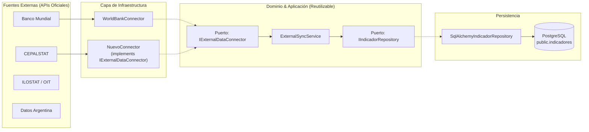

# Guía de Desarrollo: Creación de Nuevos Conectores Externos (`obspred`)

> **Propósito:** Esta guía técnica documenta el procedimiento paso a paso para que cualquier desarrollador del equipo pueda integrar una nueva fuente o API oficial externa al Observatorio Predictivo, respetando los principios de **Clean Architecture**, inversión de dependencias y trazabilidad.

---

## 1. Arquitectura de Ingesta y Principios de Diseño

El sistema de ingesta externa utiliza el patrón de **Puertos y Adaptadores (Arquitectura Hexagonal)**:



### 💡 ¿Por qué es modular y extensible?
- **El 70% del flujo ya está resuelto:** [`ExternalSyncService`](../app/application/services/external_sync_service.py) y [`SqlAlchemyIndicadorRepository`](../app/infrastructure/persistence/repositories/indicador_repository.py) son **100% genéricos**.
- Para sumar una nueva fuente, **no se duplica lógica de base de datos ni de orquestación**. Solo se implementa el **Adaptador** correspondiente que traduce los datos externos a la estructura unificada [`RawIndicatorRecord`](../app/domain/interfaces/external_connector.py).

---

## 2. Flujo de Desarrollo Paso a Paso

### Paso 1: Configurar Variables de Entorno y Constantes

Nunca se deben incluir URLs o credenciales *hardcodeadas* en el código.

1. **Definir constantes por defecto** en `backend/app/core/constants.py`:
   ```python
   DEFAULT_CEPALSTAT_BASE_URL: str = "https://api-cepalstat.cepal.org/cepalstat/api/v1"
   DEFAULT_CEPALSTAT_TIMEOUT_SECONDS: float = 30.0
   ```

2. **Añadir las propiedades en la configuración** en `backend/app/core/config.py`:
   ```python
   cepalstat_api_base_url: str = Field(
       default=DEFAULT_CEPALSTAT_BASE_URL,
       description="URL base oficial de la API de CEPALSTAT",
   )
   cepalstat_timeout_seconds: float = Field(
       default=DEFAULT_CEPALSTAT_TIMEOUT_SECONDS,
       description="Timeout en segundos para llamadas HTTP a CEPALSTAT",
   )
   ```

3. **Actualizar archivos de entorno** en `backend/.env` y `backend/.env.example`:
   ```env
   # CEPALSTAT (Comisión Económica para América Latina y el Caribe)
   CEPALSTAT_API_BASE_URL=https://api-cepalstat.cepal.org/cepalstat/api/v1
   CEPALSTAT_TIMEOUT_SECONDS=30.0
   ```

---

### Paso 2: Implementar el Conector (El Adaptador)

Crear un nuevo archivo en `backend/app/infrastructure/connectors/<nombre_fuente>_connector.py`.

El conector debe heredar de [`IExternalDataConnector`](../app/domain/interfaces/external_connector.py) y satisfacer el contrato:

```python
"""Conector oficial para la API de <Fuente>."""

import asyncio
from datetime import date
from typing import Any, Dict, List, Optional
import httpx

from app.core.config import settings
from app.core.logging import logger
from app.domain.interfaces.external_connector import (
    IExternalDataConnector,
    RawIndicatorRecord,
)


class MiNuevaFuenteConnector(IExternalDataConnector):
    """Adaptador de infraestructura para consumir la API de <Fuente>."""

    DEFAULT_BASE_URL: str = settings.mi_nueva_fuente_api_base_url
    DEFAULT_COUNTRIES: List[str] = ["ARG", "URY", "CHL"]
    DEFAULT_TIMEOUT_SECONDS: float = settings.mi_nueva_fuente_timeout_seconds

    # Mapeo: indicador canónico del Observatorio -> código/serie en la API externa
    INDICATOR_MAPPING: Dict[str, str] = {
        "tasa_desempleo": "CODIGO_EXTERNO_DESEMPLEO",
        "pib_per_capita": "CODIGO_EXTERNO_PIB",
    }

    def __init__(
        self,
        base_url: Optional[str] = None,
        timeout_seconds: Optional[float] = None,
    ) -> None:
        self.base_url = (base_url or self.DEFAULT_BASE_URL).rstrip("/")
        self.timeout_seconds = timeout_seconds or self.DEFAULT_TIMEOUT_SECONDS

    @property
    def source_name(self) -> str:
        """Nombre formal de la fuente para trazabilidad."""
        return "Mi Nueva Fuente"

    async def health_check(self) -> bool:
        """Verifica disponibilidad y conectividad con la API externa."""
        try:
            async with httpx.AsyncClient(timeout=10.0) as client:
                response = await client.get(f"{self.base_url}/health-o-endpoint-base")
                return response.status_code == 200
        except Exception:
            return False

    async def fetch_indicators(
        self,
        paises: Optional[List[str]] = None,
        indicadores: Optional[List[str]] = None,
        periodo_desde: Optional[str] = None,
        periodo_hasta: Optional[str] = None,
    ) -> List[RawIndicatorRecord]:
        """Extrae y normaliza indicadores concurrentemente."""
        target_countries = paises or self.DEFAULT_COUNTRIES
        target_indicators = indicadores or list(self.INDICATOR_MAPPING.keys())

        records: List[RawIndicatorRecord] = []

        # Tip: Usar asyncio.gather para consultar países/indicadores en paralelo
        tasks = [
            self._fetch_single(country, ind, periodo_desde, periodo_hasta)
            for country in target_countries
            for ind in target_indicators
            if ind in self.INDICATOR_MAPPING
        ]
        results = await asyncio.gather(*tasks, return_exceptions=True)

        for res in results:
            if isinstance(res, list):
                records.extend(res)
            elif isinstance(res, Exception):
                logger.warning("Error en consulta concurrente: %s", res)

        return records

    async def _fetch_single(
        self,
        pais: str,
        indicador: str,
        desde: Optional[str],
        hasta: Optional[str],
    ) -> List[RawIndicatorRecord]:
        # 1. Llamar al endpoint HTTP con httpx
        # 2. Parsear la respuesta JSON
        # 3. Normalizar al DTO RawIndicatorRecord
        ...
```

#### Estructura de salida esperada ([`RawIndicatorRecord`](../app/domain/interfaces/external_connector.py)):
Cada elemento debe normalizarse con estos atributos:
- **`pais`**: Código de 3 letras (`ARG`, `URY`, `CHL`).
- **`sector`**: Nombre del sector (`Tecnología`, `Salud`, etc.) o `None` si es agregado nacional.
- **`ocupacion`**: Ocupación específica o `None` si es agregado nacional.
- **`indicador`**: Nombre canónico unificado (`tasa_desempleo`, `pib_per_capita`, etc.).
- **`periodo`**: Cadena representativa del año o trimestre (`2024`, `2024-Q1`).
- **`valor`**: `float` con el valor numérico.
- **`tipo`**: `"observado"`, `"calculado"` o `"proyeccion"`.
- **`fuente`**: Nombre oficial de la fuente (`CEPALSTAT`, `ILOSTAT`, etc.).
- **`fecha_actualizacion`**: Objeto `date` con la fecha de corte del dato.

---

### Paso 3: Exponer el Endpoint HTTP en la API

En `backend/app/api/v1/endpoints/ingesta.py`:

```python
from app.infrastructure.connectors.mi_nueva_fuente_connector import (
    MiNuevaFuenteConnector,
)


@router.post(
    "/sync/mi-nueva-fuente",
    response_model=ApiResponse[ExternalSyncResultDTO],
    summary="Sincronizar indicadores desde Mi Nueva Fuente",
    description="Consume la API oficial y realiza upsert idempotente en PostgreSQL.",
)
async def sync_mi_nueva_fuente(
    payload: ExternalSyncRequestDTO = Body(default_factory=ExternalSyncRequestDTO),
    session: AsyncSession = Depends(get_db_session),
) -> ApiResponse[ExternalSyncResultDTO]:
    repository = SqlAlchemyIndicadorRepository(session)
    connector = MiNuevaFuenteConnector()
    service = ExternalSyncService(connector=connector, repository=repository)

    result = await service.sync_data(
        paises=payload.paises,
        indicadores=payload.indicadores,
        periodo_desde=payload.periodo_desde,
        periodo_hasta=payload.periodo_hasta,
    )

    if result.status == "failed":
        raise HTTPException(
            status_code=status.HTTP_502_BAD_GATEWAY,
            detail=f"Fallo en sincronización: {result.error_message}",
        )

    return ApiResponse.success(
        data=result,
        message=f"Sincronización de '{connector.source_name}' exitosa.",
    )
```

---

### Paso 4: Crear Tests Unitarios

Crear el archivo `backend/tests/unit/test_<nombre_fuente>_connector.py`.

> ⚠️ **Regla importante:** Las pruebas unitarias **nunca** deben llamar a internet real. Utilizar `unittest.mock` o `respx` para simular la respuesta HTTP.

Verificaciones requeridas:
1. **Mapeo exitoso:** El JSON simulado genera la cantidad correcta de `RawIndicatorRecord`.
2. **Ignorar nulos:** Si la API devuelve un valor nulo para un año, el conector debe omitirlo limpiamente.
3. **Manejo de errores:** Si la API responde `500` o timeout, el conector no debe lanzar una excepción no controlada, sino registrar un log de advertencia y retornar una lista vacía o reportar el error ordenadamente.

Ejecutar:
```powershell
pytest tests/unit/test_mi_nueva_fuente_connector.py -v
```

---

### Paso 5: Probar de Extremo a Extremo (E2E)

1. **Reiniciar Uvicorn** en la terminal para recargar las variables del `.env`:
   ```powershell
   uvicorn app.main:app --reload --host 0.0.0.0 --port 8000
   ```
2. **Disparar la sincronización** desde Postman o Swagger (`http://127.0.0.1:8000/docs`):
   ```http
   POST /api/v1/ingesta/sync/mi-nueva-fuente
   Content-Type: application/json

   {
     "paises": ["ARG", "URY", "CHL"],
     "indicadores": ["tasa_desempleo"]
   }
   ```
3. **Verificar en PostgreSQL:**
   ```sql
   SELECT id, pais, indicador, periodo, valor, fuente, updated_at
   FROM public.indicadores
   WHERE fuente = 'Mi Nueva Fuente'
   ORDER BY periodo DESC;
   ```
4. **Validar lectura desde la API:**
   ```http
   GET /api/v1/indicadores?fuente=Mi Nueva Fuente&pais=ARG
   ```

---

### Paso 6: Actualizar Postman y Documentación

1. Agregar el nuevo request en [`backend/docs/obspred.postman_collection.json`](obspred.postman_collection.json) con sus ejemplos de respuesta (`200 OK` y `502 Bad Gateway`).
2. Actualizar el estado de cobertura del conector en [`informe-fuentes-datos-observatorio.md`](../../documentacion/informe-fuentes-datos-observatorio.md).

---

## 3. Checklist de Control de Calidad (Definition of Done)

Antes de fusionar la rama (`PR`), asegurar que:
- [ ] La URL base y timeouts están en `.env.example`, `.env`, `constants.py` y `config.py`.
- [ ] La clase implementa la interfaz `IExternalDataConnector`.
- [ ] Se utilizó `asyncio.gather` para concurrencia eficiente.
- [ ] Se mapean los códigos de países canónicos (`ARG`, `URY`, `CHL`).
- [ ] Los registros se normalizan a `RawIndicatorRecord` con trazabilidad completa.
- [ ] La persistencia realiza **Upsert idempotente** (sin duplicar filas al re-ejecutar).
- [ ] Los tests unitarios pasan al 100% sin dependencias de red.
- [ ] El linter `ruff check .` no arroja advertencias ni errores.
- [ ] La colección de Postman incluye el nuevo endpoint y ejemplos.
