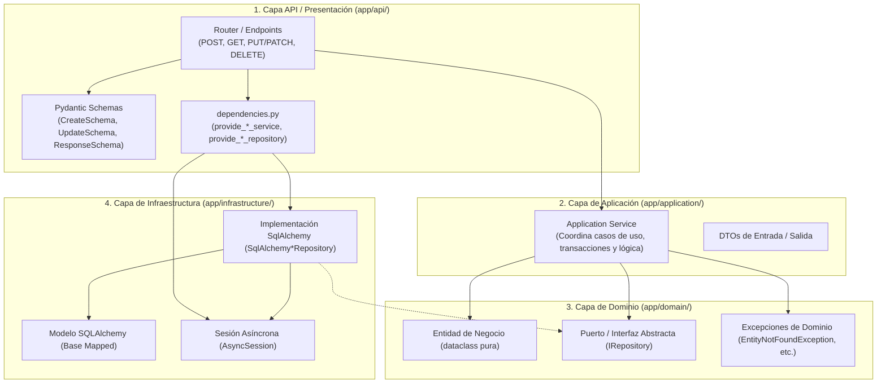

# Guía de Desarrollo: Implementación de un CRUD en el Backend (`obspred`)

> **Propósito:** Esta guía técnica describe el procedimiento integral paso a paso para implementar un nuevo módulo o recurso con operaciones **CRUD (Create, Read, Update, Delete)** en el backend de `obspred`, respetando estrictamente los principios de **Clean Architecture**, **SOLID**, **FastAPI**, **SQLAlchemy 2.0 (asíncrono)** y el estándar unificado de respuestas `ApiResponse[T]`.

---

## 1. Principios Arquitectónicos y Flujo del CRUD

En `obspred`, cada funcionalidad atraviesa las capas de la arquitectura siguiendo la **Regla de Dependencia unidireccional**: las dependencias siempre apuntan hacia adentro (el Dominio no conoce frameworks, ni ORMs, ni librerías web).



---

## 2. Los 7 Pasos para Construir un CRUD

Para ejemplificar el flujo completo de forma didáctica, utilizaremos un recurso canónico del observatorio: **`Ocupacion`** (Gestión de ocupaciones monitoreadas).

---

### Paso 1: Definir la Entidad y Excepciones en el Dominio (`app/domain/`)

El dominio define el "qué": qué datos componen el recurso y qué reglas de negocio deben cumplirse, sin importar si los datos se guardan en PostgreSQL, SQLite o memoria.

#### 1.1 Entidad de Negocio
Crea el archivo en `app/domain/entities/ocupacion.py`:

```python
"""Entidad de dominio para Ocupación."""

from dataclasses import dataclass
from datetime import datetime
from typing import Optional


@dataclass
class Ocupacion:
    """Entidad pura de dominio que representa una ocupación estratégica."""

    id: Optional[int]
    codigo: str
    nombre: str
    sector: str
    descripcion: Optional[str] = None
    activo: bool = True
    created_at: Optional[datetime] = None
    updated_at: Optional[datetime] = None

    def desactivar(self) -> None:
        """Regla de negocio: desactiva la ocupación."""
        self.activo = False
```

#### 1.2 Excepción de Dominio
Si el recurso puede no encontrarse, se utiliza `EntityNotFoundException` (de `app/domain/exceptions/base.py`) o una excepción especializada en `app/domain/exceptions/`:

```python
from app.domain.exceptions.base import EntityNotFoundException


class OcupacionNoEncontradaException(EntityNotFoundException):
    """Lanzada cuando una ocupación consultada no existe."""

    def __init__(self, identificador: str | int) -> None:
        super().__init__(
            message=f"No se encontró la ocupación con identificador '{identificador}'."
        )
```

---

### Paso 2: Definir el Puerto / Interfaz del Repositorio (`app/domain/interfaces/`)

Define el contrato abstracto que cualquier motor de persistencia debe cumplir.

Crea el archivo en `app/domain/interfaces/ocupacion_repository.py`:

```python
"""Puerto abstracto para el repositorio de persistencia de Ocupaciones."""

from abc import ABC, abstractmethod
from typing import List, Optional
from app.domain.entities.ocupacion import Ocupacion


class IOcupacionRepository(ABC):
    """Contrato abstracto con las operaciones fundamentales de persistencia (CRUD)."""

    @abstractmethod
    async def create(self, ocupacion: Ocupacion) -> Ocupacion:
        """Crea y persiste una nueva ocupación."""
        pass

    @abstractmethod
    async def get_by_id(self, ocupacion_id: int) -> Optional[Ocupacion]:
        """Obtiene una ocupación por su ID primario."""
        pass

    @abstractmethod
    async def get_by_codigo(self, codigo: str) -> Optional[Ocupacion]:
        """Obtiene una ocupación por su código unívoco."""
        pass

    @abstractmethod
    async def list_all(
        self,
        sector: Optional[str] = None,
        solo_activos: bool = True,
        skip: int = 0,
        limit: int = 100,
    ) -> List[Ocupacion]:
        """Lista ocupaciones aplicando filtros opcionales."""
        pass

    @abstractmethod
    async def update(self, ocupacion: Ocupacion) -> Ocupacion:
        """Actualiza el estado de una ocupación existente."""
        pass

    @abstractmethod
    async def delete(self, ocupacion_id: int) -> bool:
        """Elimina físicamente o marca inactiva una ocupación."""
        pass
```

No olvides exportar la interfaz en `app/domain/interfaces/__init__.py`.

---

### Paso 3: Mapeo Relacional y Repositorio en Infraestructura (`app/infrastructure/persistence/`)

#### 3.1 Modelo ORM de SQLAlchemy 2.0
Crea el modelo en `app/infrastructure/persistence/models/ocupacion.py`:

```python
"""Modelo relacional de SQLAlchemy para Ocupaciones."""

from datetime import datetime, timezone
from typing import Optional
from sqlalchemy import Boolean, DateTime, Integer, String, Text
from sqlalchemy.orm import Mapped, mapped_column
from app.infrastructure.persistence.database import Base


class OcupacionModel(Base):
    """Mapeo relacional de la tabla `ocupaciones`."""

    __tablename__ = "ocupaciones"

    id: Mapped[int] = mapped_column(
        Integer, primary_key=True, autoincrement=True, index=True
    )
    codigo: Mapped[str] = mapped_column(
        String(50), unique=True, nullable=False, index=True
    )
    nombre: Mapped[str] = mapped_column(String(150), nullable=False, index=True)
    sector: Mapped[str] = mapped_column(String(100), nullable=False, index=True)
    descripcion: Mapped[Optional[str]] = mapped_column(Text, nullable=True)
    activo: Mapped[bool] = mapped_column(Boolean, default=True, nullable=False)
    created_at: Mapped[datetime] = mapped_column(
        DateTime(timezone=True),
        default=lambda: datetime.now(timezone.utc),
        nullable=False,
    )
    updated_at: Mapped[datetime] = mapped_column(
        DateTime(timezone=True),
        default=lambda: datetime.now(timezone.utc),
        onupdate=lambda: datetime.now(timezone.utc),
        nullable=False,
    )
```

Exporta el modelo en `app/infrastructure/persistence/models/__init__.py`.

> [!NOTE]
> Para generar la tabla en base de datos mediante migraciones de Alembic:
> ```powershell
> alembic revision --autogenerate -m "crear tabla ocupaciones"
> alembic upgrade head
> ```

#### 3.2 Implementación Concreta del Repositorio
Crea `app/infrastructure/persistence/repositories/ocupacion_repository.py`:

```python
"""Implementación SQLAlchemy para el repositorio de Ocupaciones."""

from typing import List, Optional
from sqlalchemy import select
from sqlalchemy.ext.asyncio import AsyncSession

from app.domain.entities.ocupacion import Ocupacion
from app.domain.interfaces.ocupacion_repository import IOcupacionRepository
from app.infrastructure.persistence.models.ocupacion import OcupacionModel


class SqlAlchemyOcupacionRepository(IOcupacionRepository):
    """Adaptador de base de datos asíncrono para gestionar Ocupaciones."""

    def __init__(self, session: AsyncSession) -> None:
        self._session = session

    def _to_entity(self, model: OcupacionModel) -> Ocupacion:
        """Mapea un modelo ORM a la entidad pura de dominio."""
        return Ocupacion(
            id=model.id,
            codigo=model.codigo,
            nombre=model.nombre,
            sector=model.sector,
            descripcion=model.descripcion,
            activo=model.activo,
            created_at=model.created_at,
            updated_at=model.updated_at,
        )

    async def create(self, ocupacion: Ocupacion) -> Ocupacion:
        model = OcupacionModel(
            codigo=ocupacion.codigo,
            nombre=ocupacion.nombre,
            sector=ocupacion.sector,
            descripcion=ocupacion.descripcion,
            activo=ocupacion.activo,
        )
        self._session.add(model)
        await self._session.flush()
        await self._session.refresh(model)
        return self._to_entity(model)

    async def get_by_id(self, ocupacion_id: int) -> Optional[Ocupacion]:
        query = select(OcupacionModel).where(OcupacionModel.id == ocupacion_id)
        result = await self._session.execute(query)
        model = result.scalars().first()
        return self._to_entity(model) if model else None

    async def get_by_codigo(self, codigo: str) -> Optional[Ocupacion]:
        query = select(OcupacionModel).where(OcupacionModel.codigo == codigo)
        result = await self._session.execute(query)
        model = result.scalars().first()
        return self._to_entity(model) if model else None

    async def list_all(
        self,
        sector: Optional[str] = None,
        solo_activos: bool = True,
        skip: int = 0,
        limit: int = 100,
    ) -> List[Ocupacion]:
        query = select(OcupacionModel)
        if solo_activos:
            query = query.where(OcupacionModel.activo.is_(True))
        if sector:
            query = query.where(OcupacionModel.sector == sector)
        query = query.offset(skip).limit(limit)

        result = await self._session.execute(query)
        models = result.scalars().all()
        return [self._to_entity(m) for m in models]

    async def update(self, ocupacion: Ocupacion) -> Ocupacion:
        query = select(OcupacionModel).where(OcupacionModel.id == ocupacion.id)
        result = await self._session.execute(query)
        model = result.scalars().first()

        if not model:
            raise ValueError(f"No existe modelo con ID {ocupacion.id}")

        model.nombre = ocupacion.nombre
        model.sector = ocupacion.sector
        model.descripcion = ocupacion.descripcion
        model.activo = ocupacion.activo

        await self._session.flush()
        await self._session.refresh(model)
        return self._to_entity(model)

    async def delete(self, ocupacion_id: int) -> bool:
        query = select(OcupacionModel).where(OcupacionModel.id == ocupacion_id)
        result = await self._session.execute(query)
        model = result.scalars().first()
        if not model:
            return False

        await self._session.delete(model)
        await self._session.flush()
        return True
```

---

### Paso 4: Capa de Aplicación y Servicio (`app/application/services/`)

El Servicio de Aplicación contiene los casos de uso, orquesta transacciones y aplica validaciones lógicas antes de delegar a la persistencia.

Crea `app/application/services/ocupacion_service.py`:

```python
"""Servicio de aplicación para coordinar casos de uso de Ocupaciones."""

from typing import List, Optional
from app.domain.entities.ocupacion import Ocupacion
from app.domain.exceptions.base import InvalidOperationException
from app.domain.exceptions import OcupacionNoEncontradaException
from app.domain.interfaces.ocupacion_repository import IOcupacionRepository


class OcupacionService:
    """Orquesta las operaciones de negocio del CRUD de Ocupaciones."""

    def __init__(self, repository: IOcupacionRepository) -> None:
        self._repository = repository

    async def crear_ocupacion(
        self,
        codigo: str,
        nombre: str,
        sector: str,
        descripcion: Optional[str] = None,
    ) -> Ocupacion:
        existente = await self._repository.get_by_codigo(codigo)
        if existente:
            raise InvalidOperationException(
                f"Ya existe una ocupación con el código '{codigo}'."
            )

        nueva = Ocupacion(
            id=None,
            codigo=codigo.strip().upper(),
            nombre=nombre.strip(),
            sector=sector.strip(),
            descripcion=descripcion.strip() if descripcion else None,
        )
        return await self._repository.create(nueva)

    async def obtener_por_id(self, ocupacion_id: int) -> Ocupacion:
        ocupacion = await self._repository.get_by_id(ocupacion_id)
        if not ocupacion:
            raise OcupacionNoEncontradaException(ocupacion_id)
        return ocupacion

    async def listar(
        self,
        sector: Optional[str] = None,
        solo_activos: bool = True,
        skip: int = 0,
        limit: int = 100,
    ) -> List[Ocupacion]:
        return await self._repository.list_all(
            sector=sector,
            solo_activos=solo_activos,
            skip=skip,
            limit=limit,
        )

    async def actualizar(
        self,
        ocupacion_id: int,
        nombre: Optional[str] = None,
        sector: Optional[str] = None,
        descripcion: Optional[str] = None,
        activo: Optional[bool] = None,
    ) -> Ocupacion:
        ocupacion = await self.obtener_por_id(ocupacion_id)

        if nombre is not None:
            ocupacion.nombre = nombre.strip()
        if sector is not None:
            ocupacion.sector = sector.strip()
        if descripcion is not None:
            ocupacion.descripcion = descripcion.strip()
        if activo is not None:
            ocupacion.activo = activo

        return await self._repository.update(ocupacion)

    async def eliminar(self, ocupacion_id: int) -> None:
        # Verifica existencia previa (lanza 404 si no está)
        await self.obtener_por_id(ocupacion_id)
        await self._repository.delete(ocupacion_id)
```

---

### Paso 5: Esquemas Pydantic (`app/api/v1/schemas/`)

Define las entradas (Create, Update, Filters) y las salidas serializables según el estándar `ApiResponse[T]`.

Crea `app/api/v1/schemas/ocupacion_schema.py`:

```python
"""Esquemas Pydantic para el recurso Ocupación."""

from datetime import datetime
from typing import List, Optional
from pydantic import BaseModel, ConfigDict, Field
from app.api.v1.schemas.response_schema import ApiResponse


class OcupacionBaseSchema(BaseModel):
    """Campos base compartidos."""

    nombre: str = Field(
        ..., min_length=2, max_length=150, description="Nombre de la ocupación"
    )
    sector: str = Field(
        ..., min_length=2, max_length=100, description="Sector económico canónico"
    )
    descripcion: Optional[str] = Field(
        None, max_length=500, description="Descripción opcional"
    )


class OcupacionCreateSchema(OcupacionBaseSchema):
    """Payload para crear ocupación (POST)."""

    codigo: str = Field(
        ..., min_length=2, max_length=50, description="Código único de la ocupación"
    )


class OcupacionUpdateSchema(BaseModel):
    """Payload para actualización parcial (PATCH/PUT)."""

    nombre: Optional[str] = Field(None, min_length=2, max_length=150)
    sector: Optional[str] = Field(None, min_length=2, max_length=100)
    descripcion: Optional[str] = Field(None, max_length=500)
    activo: Optional[bool] = None


class OcupacionItemSchema(OcupacionBaseSchema):
    """Estructura de respuesta individual de una ocupación."""

    model_config = ConfigDict(from_attributes=True)

    id: int
    codigo: str
    activo: bool
    created_at: Optional[datetime] = None
    updated_at: Optional[datetime] = None


# Envoltorios canónicos ApiResponse[T]
OcupacionResponseSchema = ApiResponse[OcupacionItemSchema]
OcupacionListResponseSchema = ApiResponse[List[OcupacionItemSchema]]
```

---

### Paso 6: Inyección de Dependencias (`app/api/dependencies.py`)

Conecta la base de datos con el repositorio y el servicio para que FastAPI los suministre en los controladores.

Agrega en `app/api/dependencies.py`:

```python
from app.application.services.ocupacion_service import OcupacionService
from app.domain.interfaces.ocupacion_repository import IOcupacionRepository
from app.infrastructure.persistence.repositories.ocupacion_repository import (
    SqlAlchemyOcupacionRepository,
)


def provide_ocupacion_repository(
    session: Annotated[AsyncSession, Depends(provide_db_session)],
) -> IOcupacionRepository:
    """Provee la implementación concreta del repositorio de Ocupaciones."""
    return SqlAlchemyOcupacionRepository(session=session)


def provide_ocupacion_service(
    repository: Annotated[IOcupacionRepository, Depends(provide_ocupacion_repository)],
) -> OcupacionService:
    """Provee el servicio de aplicación de Ocupaciones."""
    return OcupacionService(repository=repository)
```

---

### Paso 7: Endpoints / Router y Registro Global (`app/api/v1/endpoints/`)

#### 7.1 Crear el Router
Crea `app/api/v1/endpoints/ocupaciones.py`:

```python
"""Controlador REST con operaciones CRUD para Ocupaciones."""

from typing import Annotated, List, Optional
from fastapi import APIRouter, Depends, Query, status

from app.api.dependencies import provide_ocupacion_service
from app.api.v1.schemas.ocupacion_schema import (
    OcupacionCreateSchema,
    OcupacionItemSchema,
    OcupacionListResponseSchema,
    OcupacionResponseSchema,
    OcupacionUpdateSchema,
)
from app.api.v1.schemas.response_schema import (
    ResponseMeta,
    create_success_response,
)
from app.application.services.ocupacion_service import OcupacionService

ocupaciones_router = APIRouter(
    prefix="/ocupaciones",
    tags=["Ocupaciones"],
)


@ocupaciones_router.post(
    "",
    response_model=OcupacionResponseSchema,
    status_code=status.HTTP_201_CREATED,
    summary="Crear una nueva ocupación",
)
async def crear_ocupacion(
    payload: OcupacionCreateSchema,
    service: Annotated[OcupacionService, Depends(provide_ocupacion_service)],
) -> OcupacionResponseSchema:
    entidad = await service.crear_ocupacion(
        codigo=payload.codigo,
        nombre=payload.nombre,
        sector=payload.sector,
        descripcion=payload.descripcion,
    )
    return create_success_response(
        data=OcupacionItemSchema.model_validate(entidad),
        message="Ocupación creada exitosamente.",
        status_code=status.HTTP_201_CREATED,
    )


@ocupaciones_router.get(
    "",
    response_model=OcupacionListResponseSchema,
    status_code=status.HTTP_200_OK,
    summary="Listar ocupaciones filtradas",
)
async def listar_ocupaciones(
    service: Annotated[OcupacionService, Depends(provide_ocupacion_service)],
    sector: Optional[str] = Query(None, description="Filtro opcional por sector"),
    solo_activos: bool = Query(True, description="Mostrar solo ocupaciones activas"),
    skip: int = Query(0, ge=0),
    limit: int = Query(50, ge=1, le=100),
) -> OcupacionListResponseSchema:
    lista = await service.listar(
        sector=sector, solo_activos=solo_activos, skip=skip, limit=limit
    )
    items = [OcupacionItemSchema.model_validate(item) for item in lista]
    return create_success_response(
        data=items,
        message="Listado de ocupaciones obtenido con éxito.",
        meta=ResponseMeta(
            total=len(items), extra={"sector": sector, "solo_activos": solo_activos}
        ),
    )


@ocupaciones_router.get(
    "/{ocupacion_id}",
    response_model=OcupacionResponseSchema,
    status_code=status.HTTP_200_OK,
    summary="Consultar ocupación por ID",
)
async def obtener_ocupacion(
    ocupacion_id: int,
    service: Annotated[OcupacionService, Depends(provide_ocupacion_service)],
) -> OcupacionResponseSchema:
    entidad = await service.obtener_por_id(ocupacion_id)
    return create_success_response(
        data=OcupacionItemSchema.model_validate(entidad),
        message="Ocupación obtenida exitosamente.",
    )


@ocupaciones_router.patch(
    "/{ocupacion_id}",
    response_model=OcupacionResponseSchema,
    status_code=status.HTTP_200_OK,
    summary="Actualizar parcialmente una ocupación",
)
async def actualizar_ocupacion(
    ocupacion_id: int,
    payload: OcupacionUpdateSchema,
    service: Annotated[OcupacionService, Depends(provide_ocupacion_service)],
) -> OcupacionResponseSchema:
    actualizada = await service.actualizar(
        ocupacion_id=ocupacion_id,
        nombre=payload.nombre,
        sector=payload.sector,
        descripcion=payload.descripcion,
        activo=payload.activo,
    )
    return create_success_response(
        data=OcupacionItemSchema.model_validate(actualizada),
        message="Ocupación actualizada correctamente.",
    )


@ocupaciones_router.delete(
    "/{ocupacion_id}",
    response_model=OcupacionResponseSchema,
    status_code=status.HTTP_200_OK,
    summary="Eliminar una ocupación",
)
async def eliminar_ocupacion(
    ocupacion_id: int,
    service: Annotated[OcupacionService, Depends(provide_ocupacion_service)],
) -> OcupacionResponseSchema:
    await service.eliminar(ocupacion_id)
    return create_success_response(
        data=None,
        message=f"Ocupación con ID {ocupacion_id} eliminada exitosamente.",
    )
```

#### 7.2 Registrar el Router en la Aplicación Principal
En `backend/app/main.py`:

```python
from app.api.v1.endpoints.ocupaciones import ocupaciones_router

# Dentro de create_app() o tras definir api_router:
app.include_router(ocupaciones_router, prefix=settings.api_v1_prefix)
```

---

## 3. Guía de Testing para el CRUD

Todo nuevo CRUD debe contar con tests unitarios y tests de integración.

### A. Test Unitario del Repositorio (`tests/unit/test_ocupacion_repository.py`)
Utiliza una base de datos SQLite en memoria:

```python
import pytest
from sqlalchemy.ext.asyncio import AsyncSession
from app.domain.entities.ocupacion import Ocupacion
from app.infrastructure.persistence.repositories.ocupacion_repository import (
    SqlAlchemyOcupacionRepository,
)


@pytest.mark.asyncio
async def test_crear_y_obtener_ocupacion(in_memory_session: AsyncSession) -> None:
    repo = SqlAlchemyOcupacionRepository(in_memory_session)
    nueva = Ocupacion(
        id=None,
        codigo="DEV_FRONT",
        nombre="Desarrollador Frontend",
        sector="tecnologia",
    )
    creada = await repo.create(nueva)
    assert creada.id is not None
    assert creada.codigo == "DEV_FRONT"

    recuperada = await repo.get_by_id(creada.id)
    assert recuperada is not None
    assert recuperada.nombre == "Desarrollador Frontend"
```

### B. Test de Integración del Endpoint (`tests/integration/test_ocupaciones_endpoint.py`)
Valida la respuesta HTTP completa y el envoltorio `ApiResponse`:

```python
import pytest
from httpx import AsyncClient
from app.core.config import settings


@pytest.mark.asyncio
async def test_crud_ocupaciones_flow(async_client: AsyncClient) -> None:
    base_url = f"{settings.api_v1_prefix}/ocupaciones"

    # 1. CREATE (POST)
    payload = {
        "codigo": "DATA_ENG",
        "nombre": "Data Engineer",
        "sector": "tecnologia",
        "descripcion": "Ingeniero de datos",
    }
    res_post = await async_client.post(base_url, json=payload)
    assert res_post.status_code == 201
    body = res_post.json()
    assert body["success"] is True
    ocupacion_id = body["data"]["id"]

    # 2. READ (GET by ID)
    res_get = await async_client.get(f"{base_url}/{ocupacion_id}")
    assert res_get.status_code == 200
    assert res_get.json()["data"]["codigo"] == "DATA_ENG"

    # 3. UPDATE (PATCH)
    res_patch = await async_client.patch(
        f"{base_url}/{ocupacion_id}", json={"nombre": "Senior Data Engineer"}
    )
    assert res_patch.status_code == 200
    assert res_patch.json()["data"]["nombre"] == "Senior Data Engineer"

    # 4. DELETE (DELETE)
    res_del = await async_client.delete(f"{base_url}/{ocupacion_id}")
    assert res_del.status_code == 200

    # 5. VERIFY 404 AFTER DELETE
    res_not_found = await async_client.get(f"{base_url}/{ocupacion_id}")
    assert res_not_found.status_code == 404
```

---

## 4. Checklist de Validación

Antes de dar por completado un CRUD, verifica:

- [ ] **Clean Architecture:** El dominio no importa FastAPI ni SQLAlchemy.
- [ ] **Contrato de Respuesta:** Todos los endpoints devuelven `ApiResponse[T]` mediante `create_success_response`.
- [ ] **Manejo de Errores:** Errores de negocio lanzan excepciones de dominio (`DomainException`) y son capturadas por los handlers globales (sin `raise HTTPException`).
- [ ] **Inyección de Dependencias:** El repositorio y el servicio están registrados en `app/api/dependencies.py` e inyectados con `Depends()`.
- [ ] **Trazabilidad y Tipado:** Docstrings completos en formato Google/Sphinx y tipos estrictos de Python.
- [ ] **Tests:** Pruebas unitarias para el repositorio/servicio y pruebas de integración para los 5 métodos HTTP (POST, GET lista, GET id, PATCH/PUT, DELETE).
