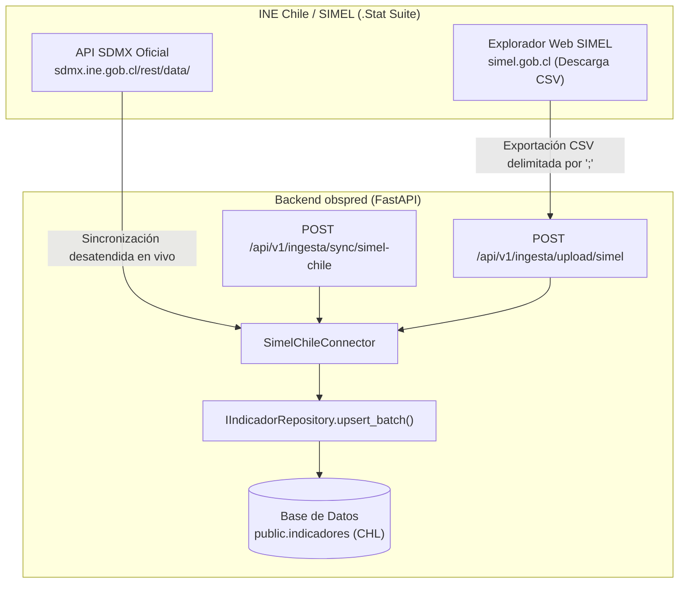

# Guía Técnica: Ingesta y Conexión Oficial con SIMEL Chile (`obspred`)

> **Propósito:** Esta guía documenta la integración del **Sistema de Información del Mercado Laboral (SIMEL)** de Chile en la plataforma `obspred`, incorporando las especificaciones de la [Guía Oficial de Uso de SIMEL (INE)](https://www.ine.gob.cl/simel/guia-de-uso), la arquitectura de la API SDMX RESTful (.Stat Suite) y el flujo de normalización de exportaciones tabulares (CSV).

---

## 1. Contexto Institucional y Arquitectura de SIMEL

### 1.1 ¿Qué es SIMEL?
SIMEL (`https://www.simel.gob.cl`) es la plataforma oficial coordinada por la **Mesa de Estadísticas del Trabajo** de Chile (integrada por el Instituto Nacional de Estadísticas - INE, el Ministerio del Trabajo y Previsión Social y con asistencia técnica de la OIT). Es la fuente primaria más exhaustiva sobre empleo, desocupación, salarios y estructura ocupacional desagregada por ramas de actividad económica (CAENES) y regiones.

### 1.2 Distinción Crítica: Portal Interactivo vs. API SDMX Oficial
De acuerdo con la [Guía de uso de SIMEL](https://www.ine.gob.cl/simel/guia-de-uso) publicada por el INE, el sistema opera bajo una arquitectura desacoplada:

1. **Portal Web Interactivo (`www.simel.gob.cl`):**
   - Interfaz gráfica para usuarios humanos construida sobre Data Explorer.
   - Cuenta con protección perimetral activa por Web Application Firewall (**WAF**) de Huawei Cloud (`Server: CW`).
   - Las solicitudes HTTP automatizadas desatendidas contra este frontend reciben el código de restricción **HTTP 418** (*I'm a teapot*).
2. **API RESTful SDMX Oficial (.Stat Suite del INE):**
   - Motor estadístico subyacente de código abierto (SIS-CC / Dotstatsuite).
   - **Endpoint oficial sin bloqueo WAF:**  
     `https://sdmx.ine.gob.cl/rest/data/CL01,<DATAFLOW>,1.0/<DIMENSIONES>?format=csv`
   - Dispone de más de 200 flujos de datos (`dataflows`) públicos actualizados periódicamente.

---

## 2. Estrategia de Ingesta en `obspred`

Para garantizar la honestidad de datos (Principio 4) y la trazabilidad (Principio 3), `obspred` provee soporte integral para **ambas vías**:



---

## 3. Especificación de la API SDMX y Flujos Priorizados

El conector [`SimelChileConnector`](../app/infrastructure/connectors/simel_chile_connector.py) consulta directamente los siguientes flujos oficiales de la agencia `CL01`:

| Dataflow ID | Indicador en `obspred` | Filtro de Dimensión SDMX | Sector Estratégico |
|---|---|---|---|
| `DF_TDES_SEXO` | `tasa_desempleo` | `M.TDES._T.AS` | `None` *(Nacional Total)* |
| `DF_TOCU_SEXO` | `tasa_ocupacion` | `M.TOCU._T.AS` | `None` *(Nacional Total)* |
| `DF_TP_SEXO` | `tasa_participacion` | `M.TP._T.AS` | `None` *(Nacional Total)* |
| `DF_OCURAMA_RAMA_SEXO` | `empleo_sector` | `M.OCURAMA._T.AS.J` | `tecnologia` (Sección J) |
| `DF_OCURAMA_RAMA_SEXO` | `empleo_sector` | `M.OCURAMA._T.AS.Q` | `salud` (Sección Q) |
| `DF_OCURAMA_RAMA_SEXO` | `empleo_sector` | `M.OCURAMA._T.AS.D` | `energia` (Sección D) |
| `DF_OCURAMA_RAMA_SEXO` | `empleo_sector` | `M.OCURAMA._T.AS.I` | `turismo` (Sección I) |
| `DF_OCURAMA_RAMA_SEXO` | `empleo_sector` | `M.OCURAMA._T.AS.M` | `economia-conocimiento` (Sección M) |

> **Convención temporal SDMX:** El INE publica trimestres móviles en notación ISO como `2024-03-01/P3M` (trimestre móvil terminado en marzo). El conector lo normaliza automáticamente a `2024-Q1`.

---

## 4. Normalización de Archivos CSV Exportados

Tal como señala la [Guía de uso de SIMEL](https://www.ine.gob.cl/simel/guia-de-uso):
- **Formato:** Texto plano con codificación **UTF-8** o **Latin-1/CP1252**.
- **Delimitador:** Punto y coma (`;`) o coma (`,`).
- **Columna de valor numérico:** `OBS_VALUE` en exportaciones SDMX o `Valor` / `Cifra` en el Explorador web.
- **Decimales:** Punto (`.`) o coma (`8,5` $\to$ `8.5`).

El método `parse_simel_csv()` detecta automáticamente la variante del archivo y normaliza todos los registros.

---

## 5. Endpoints de la API

### 5.1 Sincronización en Vivo vía API SDMX
- **Ruta:** `POST /api/v1/ingesta/sync/simel-chile`
- **Payload (opcional):**
  ```json
  {
    "paises": ["CHL"],
    "indicadores": ["tasa_desempleo", "empleo_sector"],
    "periodo_desde": "2024"
  }
  ```
- **Respuesta exitosa (`HTTP 200 OK`):**
  ```json
  {
    "success": true,
    "status_code": 200,
    "message": "Sincronización de 'SIMEL - INE Chile' exitosa.",
    "data": {
      "source": "SIMEL - INE Chile",
      "status": "success",
      "total_fetched": 186,
      "total_persisted": 186,
      "execution_time_seconds": 3.42,
      "countries_synced": ["CHL"],
      "indicators_synced": ["empleo_sector", "tasa_desempleo"],
      "error_message": null
    }
  }
  ```

### 5.2 Carga de Archivo CSV Exportado
- **Ruta:** `POST /api/v1/ingesta/upload/simel`
- **Content-Type:** `multipart/form-data`
- **Parámetro:** `file` (`.csv`)
- **Respuesta (`HTTP 201 Created`):** Valida, almacena el archivo para trazabilidad y persiste las observaciones normalizadas en la base de datos.

---

## 6. Recursos y Comandos de Prueba

1. **Dataset de prueba local:**  
   [`data/examples/simel_chile_sample.csv`](../../data/examples/simel_chile_sample.csv)
2. **Script de verificación y diagnóstico:**  
   ```bash
   .venv/Scripts/python backend/test_conexion_simel.py
   ```
   *(Comprueba la conectividad con `sdmx.ine.gob.cl`, extrae indicadores en vivo para Chile y parsea el CSV de muestra).*
3. **Pruebas automatizadas (Pytest):**  
   ```bash
   .venv/Scripts/pytest backend/tests/unit/test_simel_connector.py
   .venv/Scripts/pytest backend/tests/integration/test_simel_endpoint.py
   ```
