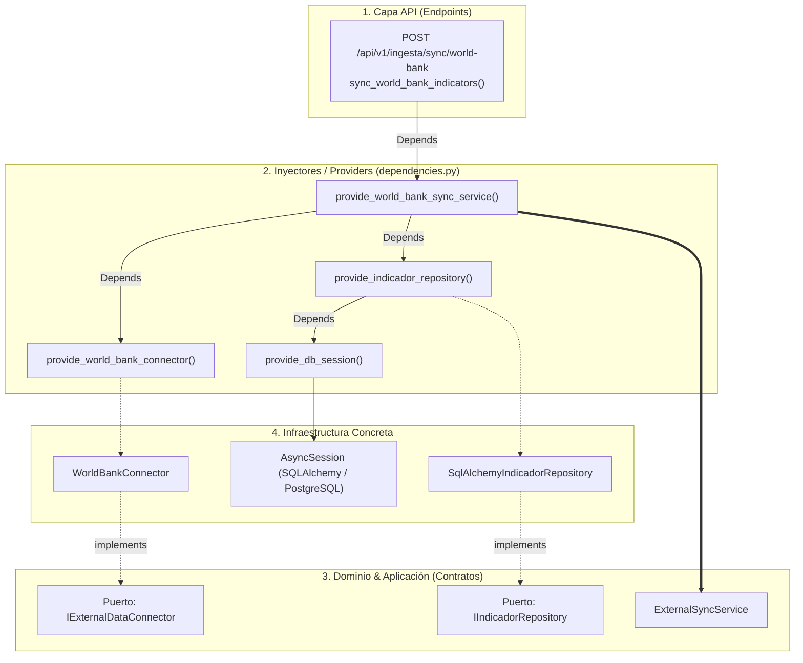

# Inyección de Dependencias en el Backend (`dependencies.py`)

> **Propósito:** Explicar cómo funciona el patrón de **Inyección de Dependencias (Dependency Injection - DI)** en el backend de `obspred`, cómo se aplica el principio de **Inversión de Dependencias (DIP)** de SOLID y cómo desacoplar la lógica de negocio de la infraestructura técnica y los frameworks web.

---

## 1. Conceptos Fundamentales: ¿Qué es y qué NO es?

### ❌ Lo que NO es: los archivos `__init__.py`
Los archivos `__init__.py` **no son inyección de dependencias**. Son archivos estándar del intérprete de Python cuya función es:
1. Declarar que una carpeta es un paquete/módulo importable.
2. Servir como "fachada" pública (`__all__`), exponiendo clases e interfaces para que los imports sean limpios (ej. `from app.domain.interfaces import IIndicadorRepository`).

### ✅ Lo que SÍ es: Inyección de Dependencias
Es un patrón de diseño donde una clase o función **recibe sus colaboradores externos desde afuera** en lugar de instanciarlos internamente con `new` o llamadas directas (`Clase()`).

- **Sin Inyección (Acoplado):**
  ```python
  # ❌ MAL: El servicio está fuertemente acoplado a SQLAlchemy y a Postgres
  class ExternalSyncService:
      def __init__(self):
          self.repository = SqlAlchemyIndicadorRepository()  # No se puede testear con mocks fácilmente
  ```

- **Con Inyección (Desacoplado - Clean Architecture):**
  ```python
  # ✅ BIEN: El servicio solo depende de una interfaz abstracta
  class ExternalSyncService:
      def __init__(self, repository: IIndicadorRepository, connector: IExternalDataConnector):
          self.repository = repository
          self.connector = connector
  ```

---

## 2. Flujo de Inyección en `obspred`

FastAPI implementa un contenedor de inyección nativo mediante el decorador y función `Depends()`.

Toda la configuración del árbol de dependencias del backend está centralizada en:
👉 [`backend/app/api/dependencies.py`](../app/api/dependencies.py)



---

## 3. Anatomía del Código

### A. Los "Proveedores" o Factories (`app/api/dependencies.py`)
Cada componente tiene una función constructora con prefijo `provide_*`. FastAPI resuelve automáticamente la jerarquía de dependencias en cadena:

```python
# 1. Provee la sesión de base de datos por petición (abre y cierra transacciones)
async def provide_db_session() -> AsyncGenerator[AsyncSession, None]:
    async for session in get_db_session():
        yield session

# 2. Provee el conector de API externa configurado
def provide_world_bank_connector() -> IExternalDataConnector:
    return WorldBankConnector(
        base_url=settings.world_bank_api_base_url,
        timeout=settings.world_bank_timeout_seconds,
    )

# 3. Provee el repositorio inyectándole la sesión de DB
def provide_indicador_repository(
    session: Annotated[AsyncSession, Depends(provide_db_session)],
) -> IIndicadorRepository:
    return SqlAlchemyIndicadorRepository(session=session)

# 4. Provee el servicio de aplicación inyectándole el conector y el repositorio
def provide_world_bank_sync_service(
    connector: Annotated[IExternalDataConnector, Depends(provide_world_bank_connector)],
    repository: Annotated[IIndicadorRepository, Depends(provide_indicador_repository)],
) -> ExternalSyncService:
    return ExternalSyncService(connector=connector, repository=repository)
```

### B. El Endpoint / Controller (`app/api/v1/endpoints/ingesta.py`)
El endpoint **no sabe cómo se conecta la base de datos ni cómo se construye el conector**. Solo pide el servicio listo para usar:

```python
@router.post("/sync/world-bank")
async def sync_world_bank_indicators(
    sync_service: Annotated[
        ExternalSyncService,
        Depends(provide_world_bank_sync_service),
    ],
    payload: Optional[SyncExternalDataRequestSchema] = None,
):
    result = await sync_service.sync_data(...)
    return result
```

---

## 4. Beneficios Clave para el Proyecto

1. **Testabilidad Absoluta (Mocks sin red ni DB real):**
   En los tests de integración (`tests/integration/test_sync_endpoint.py`), podemos reemplazar cualquier proveedor en FastAPI con `app.dependency_overrides`:
   ```python
   # En el test, reemplazamos el conector real por uno falso (Mock)
   app.dependency_overrides[provide_world_bank_connector] = lambda: MockConnector()
   ```
2. **Ciclo de Vida Controlado:**
   La sesión de base de datos (`AsyncSession`) se crea al recibir el request HTTP y se cierra/libera automáticamente al responder, evitando fugas de memoria o conexiones huérfanas en la base de datos.
3. **Cumplimiento de Clean Architecture:**
   Si el día de mañana se cambia PostgreSQL por MongoDB, o `WorldBankConnector` por otra librería HTTP, **los servicios de aplicación y los endpoints no sufren ningún cambio**. Solo se modifica la implementación en `infrastructure/` y el proveedor en `dependencies.py`.
