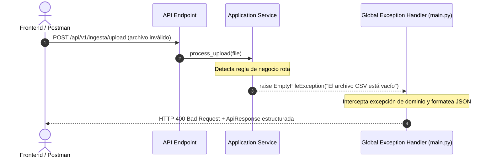

# Manejo de Errores y Excepciones (`backend`)

> **Propósito:** Documentar la estrategia de propagación y formateo de errores en el backend de `obspred`, garantizando que ninguna excepción interna quede sin capturar y que todas las respuestas de error respeten el estándar unificado `ApiResponse[T]`.

---

## 1. Principio Fundamental: Separación de Negocio y HTTP

En Clean Architecture:
- La lógica de negocio (`domain/` y `application/`) **nunca debe lanzar excepciones de frameworks web** como `HTTPException` de FastAPI.
- El dominio lanza **excepciones de dominio tipadas** (herederas de `DomainException`).
- Los **manejadores globales de excepciones** (`exception handlers`) registrados en `app/main.py` interceptan estas excepciones y las transforman en respuestas HTTP estructuradas.



---

## 2. Jerarquía de Excepciones del Dominio

Todas las excepciones de negocio derivan de `DomainException` en `app/domain/exceptions/`:

```text
DomainException (app.domain.exceptions.base)
├── EntityNotFoundException (HTTP 404)
├── InvalidOperationException (HTTP 400)
├── FileUploadException (app.domain.exceptions.file_upload)
│   ├── EmptyFileException (HTTP 400)
│   ├── FileTooLargeException (HTTP 413)
│   ├── InvalidFileExtensionException (HTTP 400)
│   ├── InvalidFileContentException (HTTP 400)
│   └── StorageWriteException (HTTP 500)
└── IndiceEmpleabilidadException (app.domain.exceptions.indice_empleabilidad)
    ├── OcupacionNoEncontradaException (HTTP 404)
    └── DatosInsuficientesException (HTTP 422)
```

---

## 3. Manejadores Globales Registrados (`app/main.py`)

La función `register_exception_handlers(app: FastAPI)` en `app/main.py` centraliza la captura de todos los tipos de errores:

### 1. `EntityNotFoundException` $\rightarrow$ `HTTP 404 Not Found`
Lanzada cuando un recurso (ocupación, indicador, dataset) no existe.
```json
{
  "success": false,
  "status_code": 404,
  "message": "La ocupación 'astronauta' no fue encontrada en los registros.",
  "data": null,
  "errors": [
    {
      "code": "ENTITY_NOT_FOUND",
      "detail": "La ocupación 'astronauta' no fue encontrada en los registros.",
      "field": "Ocupacion"
    }
  ],
  "meta": null,
  "timestamp": "2026-10-12T19:30:00.000000Z"
}
```

### 2. `FileUploadException` y derivadas $\rightarrow$ `HTTP 400 / 413 / 500`
Captura violaciones de formato, peso o integridad en la subida de archivos CSV.

### 3. `RequestValidationError` $\rightarrow$ `HTTP 422 Unprocessable Entity`
Captura automáticamente parámetros faltantes o tipos incorrectos en esquemas Pydantic o query params:
```json
{
  "success": false,
  "status_code": 422,
  "message": "Error de validación en los datos de la solicitud.",
  "data": null,
  "errors": [
    {
      "code": "VALIDATION_ERROR",
      "detail": "Field required",
      "field": "body -> indicador"
    }
  ],
  "meta": null,
  "timestamp": "2026-10-12T19:30:00.000000Z"
}
```

### 4. `StarletteHTTPException` $\rightarrow$ Respuestas de rutas o abortos HTTP
Maneja rutas inexistentes (HTTP 404 de framework) o métodos no permitidos (HTTP 405).

### 5. `Exception` (Captura universal) $\rightarrow$ `HTTP 500 Internal Server Error`
Cualquier error inesperado o bug no controlado se registra en los logs de Uvicorn con `logger.exception()` y devuelve una respuesta segura al cliente, **sin filtrar detalles sensibles del sistema interno**.

---

## 4. Códigos de Error Máquina Canónicos (`code`)

| Código de Error | Código HTTP | Cuándo se emite |
|---|---|---|
| `ENTITY_NOT_FOUND` | 404 | El recurso solicitado por ID/slug no existe en la base. |
| `VALIDATION_ERROR` | 422 | Error en tipos, formatos o campos obligatorios de Pydantic. |
| `EMPTY_FILE` | 400 | Archivo de ingesta con 0 bytes o solo espacios en blanco. |
| `FILE_TOO_LARGE` | 413 | Archivo excede el límite configurado (`STORAGE_MAX_FILE_SIZE_BYTES`). |
| `INVALID_FILE_EXTENSION` | 400 | Archivo con extensión distinta de `.csv`. |
| `INVALID_FILE_CONTENT` | 400 | Archivo ejecutable/binario disfrazado con extensión `.csv`. |
| `INSUFFICIENT_DATA` | 422 | No se cumplen los períodos históricos mínimos para calcular proyecciones o índices. |
| `EXTERNAL_CONNECTOR_ERROR` | 502 | Fallo de red, timeout o respuesta no válida de una API externa (World Bank, CEPAL). |
| `INTERNAL_SERVER_ERROR` | 500 | Error no controlado o fallo crítico en persistencia. |

---

## 5. Cómo Crear una Nueva Excepción de Dominio

1. Crear la clase en `app/domain/exceptions/<modulo>.py` heredando de `DomainException`:
   ```python
   from app.domain.exceptions.base import DomainException


   class ConectorNoDisponibleException(DomainException):
       """Se lanza cuando un conector externo está deshabilitado."""

       def __init__(self, nombre_fuente: str) -> None:
           super().__init__(f"La fuente externa '{nombre_fuente}' no se encuentra activa.")
           self.nombre_fuente = nombre_fuente
   ```
2. Registrar el manejador en `app/main.py`:
   ```python
   @app.exception_handler(ConectorNoDisponibleException)
   async def conector_no_disponible_handler(
       request: Request, exc: ConectorNoDisponibleException
   ):
       return JSONResponse(
           status_code=status.HTTP_503_SERVICE_UNAVAILABLE,
           content=create_error_response(
               message=exc.message,
               status_code=status.HTTP_503_SERVICE_UNAVAILABLE,
               errors=[
                   ErrorDetail(
                       code="CONNECTOR_UNAVAILABLE",
                       detail=exc.message,
                       field=exc.nombre_fuente,
                   )
               ],
           ).model_dump(mode="json"),
       )
   ```
