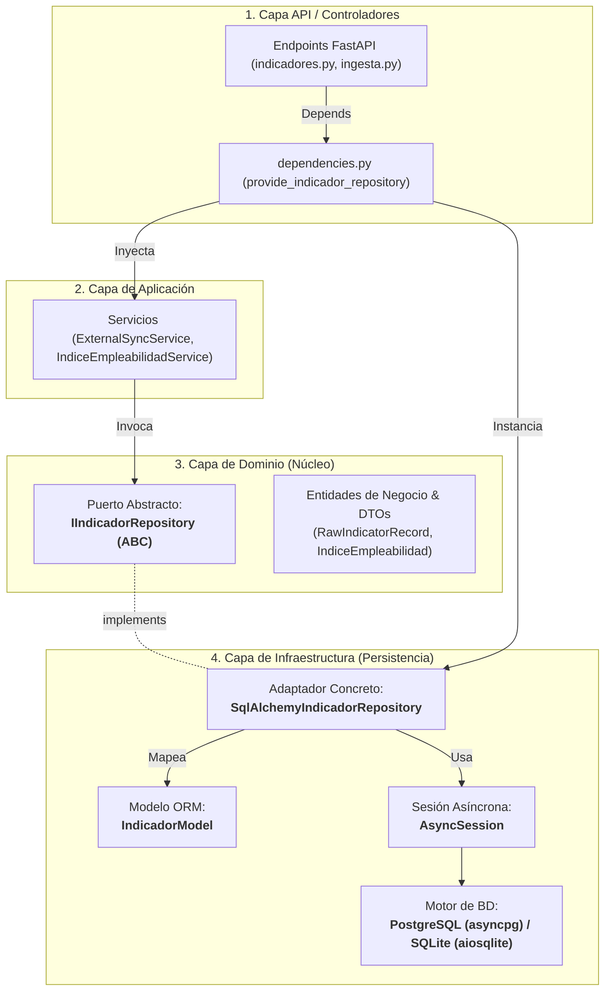

# Patrón Repositorio y Persistencia en Base de Datos (`backend`)

> **Propósito:** Documentar la implementación del **Patrón Repositorio (Repository Pattern)** y la estrategia de persistencia en base de datos bajo **Clean Architecture** y **SQLAlchemy 2.0 asíncrono** en el backend de `obspred`.

---

## 1. Filosofía y Principios de Diseño

El **Patrón Repositorio** actúa como un mediador entre la capa de dominio/aplicación y la capa de almacenamiento físico (base de datos relacional). Su objetivo primordial es desacoplar las reglas de negocio de la tecnología de persistencia subyacente.

### ¿Por qué usamos el Patrón Repositorio en `obspred`?
1. **Aislamiento del Dominio (Clean Architecture):** Los casos de uso y las entidades del Observatorio manipulan datos sin importarles si provienen de PostgreSQL, SQLite, un archivo tabular o una API externa.
2. **Tratamiento como Colección en Memoria (*Collection-like Interface*):** El repositorio expone métodos declarativos y semánticos (`upsert_batch`, `get_by_filters`, `get_by_ocupacion`, `exists_ocupacion`) en lugar de filtrar con SQL directo en los servicios o controladores.
3. **Inversión de Dependencias (SOLID - DIP):** La capa de Dominio define el **Puerto** (`IIndicadorRepository`, `IIndiceEmpleabilidadRepository`) mediante clases abstractas puras (`abc.ABC`). La capa de Infraestructura implementa el **Adaptador** concreto con SQLAlchemy (`SqlAlchemyIndicadorRepository`).
4. **Testabilidad Aislada:** Permite testear servicios de aplicación y controladores usando dobles de prueba (Mocks o Repositorios en memoria) sin necesidad de levantar una base de datos real.



---

## 2. Anatomía de la Persistencia: Componentes y Responsabilidades

| Componente | Ubicación | Responsabilidad |
|---|---|---|
| **Puerto Abstracto** | `app/domain/interfaces/` | Define el contrato abstracto (`ABC`) que el dominio exige para interactuar con datos. No contiene código SQL ni referencias a librerías ORM. |
| **Modelo ORM** | `app/infrastructure/persistence/models/` | Modela la tabla relacional (`IndicadorModel`) mapeando tipos, restricciones (`nullable`, `index`) y claves primarias. |
| **Repositorio Concreto** | `app/infrastructure/persistence/repositories/` | Implementa el puerto utilizando SQLAlchemy 2.0 asíncrono, construyendo queries (`select`, `where`), manejando transacciones y traduciendo modelos ORM a estructuras del dominio. |
| **Fábrica de Sesiones** | `app/infrastructure/persistence/database.py` | Configura el motor asíncrono (`engine`), el pool de conexiones y el generador de contexto transaccional (`get_db_session`). |
| **Inyector / Provider** | `app/api/dependencies.py` | Resuelve la sesión activa y construye el repositorio concreto para inyectarlo en servicios y controladores. |

---

## 3. Configuración del Motor y Sesiones Asíncronas (`database.py`)

El backend utiliza **SQLAlchemy 2.0 (modo asyncio nativo)** con soporte dual para desarrollo y producción:

* **PostgreSQL:** Driver `asyncpg` (`postgresql+asyncpg://...`), con pool de conexiones configurado para alta concurrencia.
* **SQLite:** Driver `aiosqlite` (`sqlite+aiosqlite:///...`), utilizado para desarrollo rápido local y pruebas.

### Configuración del Pool y Optimización de Conexiones
```python
# app/infrastructure/persistence/database.py
engine_options: dict[str, Any] = {
    "echo": settings.database_echo,
    "future": True,
}

# Parámetros de pool optimizados para entornos de producción (PostgreSQL)
if not settings.database_url.startswith("sqlite"):
    engine_options.update(
        {
            "pool_size": 10,  # Conexiones persistentes en el pool
            "max_overflow": 20,  # Conexiones adicionales permitidas bajo carga pico
            "pool_pre_ping": True,  # Verifica que la conexión esté viva antes de entregarla (evita timeouts huérfanos)
        }
    )

engine = create_async_engine(settings.database_url, **engine_options)

async_session_factory = async_sessionmaker(
    bind=engine,
    autoflush=False,
    expire_on_commit=False,  # Preserva atributos de objetos ORM tras commit()
    class_=AsyncSession,
)
```

### Ciclo de Vida de la Sesión por Request HTTP
La función generadora `get_db_session()` asegura que cada petición HTTP cuente con una sesión aislada con manejo transaccional automático:

```python
async def get_db_session() -> AsyncGenerator[AsyncSession, None]:
    async with async_session_factory() as session:
        try:
            yield session
        except Exception:
            await session.rollback()  # Revierte cambios ante fallos no controlados
            raise
        finally:
            await session.close()  # Libera la conexión de regreso al pool
```

---

## 4. Definición de Puertos de Dominio (Interfaces)

El dominio define sus requerimientos en forma de contratos abstractos puros. Por ejemplo, [`IIndicadorRepository`](file:///c:/repos/obspred/backend/app/domain/interfaces/indicador_repository.py):

```python
# app/domain/interfaces/indicador_repository.py
from abc import ABC, abstractmethod
from app.domain.interfaces.external_connector import RawIndicatorRecord
from app.infrastructure.persistence.models.indicador import IndicadorModel


class IIndicadorRepository(ABC):
    """Puerto abstracto para operaciones de persistencia y consulta de indicadores."""

    @abstractmethod
    async def upsert_batch(self, records: list[RawIndicatorRecord]) -> int:
        """Inserta o actualiza un lote de registros de forma idempotente."""
        pass

    @abstractmethod
    async def get_by_filters(
        self,
        pais: str | None = None,
        sector: str | None = None,
        ocupacion: str | None = None,
        indicador: str | None = None,
        desde: str | None = None,
        hasta: str | None = None,
    ) -> list[IndicadorModel]:
        """Consulta registros aplicando la jerarquía estricta de filtros."""
        pass
```

> 📌 **Regla de Oro:** Los métodos de los repositorios aceptan tipos del dominio (`RawIndicatorRecord`, parámetros primitivos sanitizados) y devuelven modelos o entidades, manteniendo la lógica desacoplada.

---

## 5. Estrategias de Persistencia en los Repositorios

### A. Estrategia de Upsert Lógico e Idempotencia (`upsert_batch`)
En el Observatorio, múltiples sincronizaciones externas (APIs del Banco Mundial, ILOSTAT, etc.) o cargas de archivos CSV pueden procesar indicadores idénticos para el mismo territorio y período. Para asegurar **idempotencia total**, el repositorio aplica una lógica de actualización o inserción (*Upsert*) basada en una **clave lógica de unicidad**:

$$\text{Clave Lógica} = (\text{pais}, \text{sector}, \text{ocupacion}, \text{indicador}, \text{periodo}, \text{fuente})$$

#### Implementación en [`SqlAlchemyIndicadorRepository`](file:///c:/repos/obspred/backend/app/infrastructure/persistence/repositories/indicador_repository.py#L25-L93):
1. **Evaluación de Nulos Explícita:** Dado que `sector` u `ocupacion` pueden ser `NULL` para indicadores agregados nacionales (como desempleo general), la búsqueda compara explícitamente mediante `.is_(None)` para evitar colisiones:
   ```python
   query = select(IndicadorModel).where(
       IndicadorModel.pais == record.pais,
       IndicadorModel.indicador == record.indicador,
       IndicadorModel.periodo == record.periodo,
       IndicadorModel.fuente == record.fuente,
   )
   if record.sector is not None:
       query = query.where(IndicadorModel.sector == record.sector)
   else:
       query = query.where(IndicadorModel.sector.is_(None))

   if record.ocupacion is not None:
       query = query.where(IndicadorModel.ocupacion == record.ocupacion)
   else:
       query = query.where(IndicadorModel.ocupacion.is_(None))
   ```
2. **Actualización vs Inserción:**
   - Si el registro existe: se actualizan `valor`, `tipo`, `fecha_actualizacion` y `updated_at`.
   - Si no existe: se crea una nueva instancia de `IndicadorModel` y se añade a la sesión (`session.add(new_model)`).
3. **Commit Atómico en Lote:** Al finalizar el bucle, se ejecuta `await self._session.commit()`, garantizando que todo el lote se persista en una única transacción atómica.

---

### B. Consultas Dinámicas con Jerarquía de Filtros (`get_by_filters`)
Siguiendo el **Principio 9 de AGENTS.md** (*Jerarquía estricta de filtros: País $\rightarrow$ Sector $\rightarrow$ Ocupación $\rightarrow$ Período*), las consultas se construyen dinámicamente utilizando sentencias preparadas de SQLAlchemy 2.0:

```python
# app/infrastructure/persistence/repositories/indicador_repository.py
stmt = select(IndicadorModel)

if pais:
    stmt = stmt.where(IndicadorModel.pais == pais.upper().strip())
if sector:
    stmt = stmt.where(IndicadorModel.sector == sector.strip())
if ocupacion:
    stmt = stmt.where(IndicadorModel.ocupacion == ocupacion.strip())
if indicador:
    stmt = stmt.where(IndicadorModel.indicador == indicador.strip())
if desde:
    stmt = stmt.where(IndicadorModel.periodo >= desde.strip())
if hasta:
    stmt = stmt.where(IndicadorModel.periodo <= hasta.strip())

# Ordenamiento cronológico canónico
stmt = stmt.order_by(IndicadorModel.periodo.asc(), IndicadorModel.pais.asc())

result = await self._session.execute(stmt)
return list(result.scalars().all())
```

* **Seguridad:** Los parámetros se pasan compilados a través del ORM, eliminando cualquier vector de inyección SQL.
* **Índices aprovechados:** La consulta aprovecha los índices compuestos `ix_indicadores_pais_sector_ocupacion` e `ix_indicadores_busqueda_temporal`.

---

### C. Repositorio Híbrido: Catálogo Metodológico y Persistencia Relacional
En [`SqlAlchemyIndiceEmpleabilidadRepository`](file:///c:/repos/obspred/backend/app/infrastructure/persistence/repositories/indice_empleabilidad_repository.py), se utiliza un patrón híbrido:

1. **Catálogo Taxonómico en Memoria:** Contiene la metodología oficial de ponderación (Demanda 35%, Estabilidad salarial 25%, Cobertura formativa 20%, Crecimiento 20%) y aliases de búsqueda para las ~20 ocupaciones clave en los 5 sectores estratégicos.
2. **Fallback y Agregación en Base de Datos:** Si una ocupación no pertenece al catálogo estático o se requiere verificar datos empíricos en base de datos, el repositorio consulta la tabla `indicadores` mediante agregaciones (`func.count`, `select(IndicadorModel)`).
3. **Normalización Unicode NFKD:** El repositorio normaliza denominaciones, slugs y variantes ortográficas mediante `_normalize_string()` para asegurar búsquedas tolerantes a acentos y mayúsculas.

---

## 6. Inyección de Dependencias y Cableado (`dependencies.py`)

FastAPI resuelve las dependencias de persistencia encadenando generadores y proveedores:

```python
# app/api/dependencies.py
from typing import Annotated, AsyncGenerator
from fastapi import Depends
from sqlalchemy.ext.asyncio import AsyncSession
from app.domain.interfaces.indicador_repository import IIndicadorRepository
from app.infrastructure.persistence.database import get_db_session
from app.infrastructure.persistence.repositories.indicador_repository import (
    SqlAlchemyIndicadorRepository,
)


# 1. Inyector de sesión transaccional
async def provide_db_session() -> AsyncGenerator[AsyncSession, None]:
    async for session in get_db_session():
        yield session


# 2. Inyector de repositorio tipado bajo la interfaz abstracta
def provide_indicador_repository(
    session: Annotated[AsyncSession, Depends(provide_db_session)],
) -> IIndicadorRepository:
    return SqlAlchemyIndicadorRepository(session=session)
```

### Consumo en Controladores
Los endpoints no conocen la base de datos ni SQLAlchemy; solo solicitan la abstracción `IIndicadorRepository`:

```python
# app/api/v1/endpoints/indicadores.py
@indicadores_router.get("", response_model=IndicadoresResponseSchema)
async def get_indicadores(
    filtros: Annotated[IndicadoresFilterSchema, Query()],
    repository: Annotated[IIndicadorRepository, Depends(provide_indicador_repository)],
) -> IndicadoresResponseSchema:
    db_records = await repository.get_by_filters(...)
    ...
```

---

## 7. Estrategia de Pruebas (Testing) de la Persistencia

El patrón repositorio permite dos niveles de pruebas claramente diferenciados:

### 1. Pruebas Unitarias de Repositorio ([`test_indicador_repository.py`](file:///c:/repos/obspred/backend/tests/unit/test_indicador_repository.py))
Utilizan una sesión asíncrona de SQLite en memoria (`sqlite+aiosqlite:///:memory:`) recreando el esquema mediante `Base.metadata.create_all`:
* Valida la inserción de lotes.
* Valida la idempotencia del upsert (ejecución duplicada sin crear registros extras).
* Valida los filtros jerárquicos y límites temporales.

### 2. Pruebas de Integración con Sobrescritura de Dependencias (`dependency_overrides`)
Para probar endpoints sin depender de base de datos externa, FastAPI permite sustituir el repositorio por un Mock o Fake:

```python
# En tests de integración:
app.dependency_overrides[provide_indicador_repository] = lambda: (
    FakeIndicadorRepository()
)
```

---

## 8. Guía de Creación de un Nuevo Repositorio (Paso a Paso)

Cuando se necesite persistir una nueva entidad de negocio:

1. **Definir la Interfaz de Dominio:** Crear `I<Entidad>Repository` en `app/domain/interfaces/<entidad>_repository.py` con métodos abstractos.
2. **Definir el Modelo ORM:** Si requiere una tabla nueva, modelar `<Entidad>Model(Base)` en `app/infrastructure/persistence/models/<entidad>.py` y generar la migración con Alembic (`alembic revision --autogenerate -m "create_<entidad>_table"`).
3. **Implementar el Repositorio Concreto:** Crear `SqlAlchemy<Entidad>Repository` en `app/infrastructure/persistence/repositories/<entidad>_repository.py`, recibiendo `session: AsyncSession`.
4. **Registrar el Inyector:** Agregar `provide_<entidad>_repository()` en `app/api/dependencies.py` retornando el tipo abstracto `I<Entidad>Repository`.
5. **Escribir Pruebas:**
   - Test unitario de la implementación con SQLite en memoria en `tests/unit/test_<entidad>_repository.py`.
   - Test de integración del endpoint en `tests/integration/`.

---

## 9. Documentación Relacionada

- 📖 [Arquitectura de Capas y Principios de Diseño (`arquitectura-y-capas.md`)](file:///c:/repos/obspred/backend/docs/arquitectura-y-capas.md)
- 📖 [Guía de Base de Datos y Migraciones con Alembic (`guia-base-datos-y-migraciones.md`)](file:///c:/repos/obspred/backend/docs/guia-base-datos-y-migraciones.md)
- 📖 [Inyección de Dependencias (`inyeccion-de-dependencias.md`)](file:///c:/repos/obspred/backend/docs/inyeccion-de-dependencias.md)
- 📖 [Guía de Creación de CRUDs (`guia-creacion-crud.md`)](file:///c:/repos/obspred/backend/docs/guia-creacion-crud.md)
- 📖 [Guía de Testing y Calidad (`guia-de-testing-y-calidad.md`)](file:///c:/repos/obspred/backend/docs/guia-de-testing-y-calidad.md)
