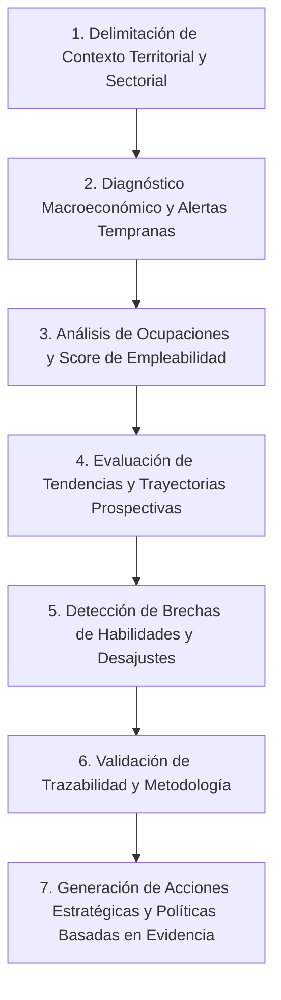

# Especificación de Caso de Uso de Negocio (Business Use Case)
## Observatorio Predictivo de Tendencias Socioeconómicas, Laborales y Educativas (`obspred`)

**Proyecto:** Observatorio Predictivo · innova.lab (Grupo N° 5 / Equipo 26)  
**Versión:** 1.0  
**Fecha:** Octubre 2026  
**Estado:** Aprobado / Referencia de Negocio  

---

## 1. Resumen y Propósito del Caso de Uso

Este documento formaliza el **Macro Caso de Uso de Negocio** que define la razón de ser, el alcance operativo y los objetivos de valor del Observatorio Predictivo. Modela cómo los diferentes actores estratégicos interactúan con la plataforma para transformar datos estadísticos oficiales y fragmentados de la región (Argentina, Uruguay y Chile) en decisiones fundamentadas de formación, empleo y desarrollo productivo.

---

## 2. Ficha Formal del Caso de Uso de Negocio

| Elemento | Descripción |
|---|---|
| **Identificador** | **CUN-01** |
| **Nombre** | **Monitoreo Estratégico y Prospectivo del Mercado Laboral-Educativo para la Toma de Decisiones Basadas en Evidencia** |
| **Nivel** | Resumen Estratégico de Negocio (Enterprise / Business Use Case) |
| **Alcance** | Plataforma Integral del Observatorio Predictivo (`obspred`) |
| **Actores Principales** | • **Gestor de Políticas Públicas:** Funcionarios de Ministerios de Trabajo, Educación y Desarrollo Económico. • **Directivo de Institución Educativa:** Autoridades universitarias y de formación técnico-profesional. • **Analista de Mercado y Productividad:** Investigadores y equipos técnicos sectoriales. |
| **Actores de Soporte / Proveedores** | Organismos oficiales de estadística y empleo (INDEC, MTESS, INE Uruguay, INE Chile, SENCE, ILOSTAT, CEPAL, Banco Mundial). |
| **Disparador (Trigger)** | La necesidad institucional de diseñar una política de empleo, actualizar una currícula formativa, anticipar desajustes de cualificación o evaluar el impacto macroeconómico en sectores clave. |
| **Precondiciones de Negocio** | 1. Existencia y disponibilidad de fuentes oficiales verificadas (APIs y/o datasets estructurados). 2. Definición del catálogo homologado de sectores estratégicos (5), ocupaciones prioritarias (~20) y taxonomías de competencias. |
| **Garantías de Éxito (Postcondiciones)** | 1. El actor dispone de un diagnóstico multidimensional sustentado por evidencia auditable. 2. Se identifican ocupaciones de alta empleabilidad y brechas de habilidades críticas. 3. Todo dato exhibe trazabilidad completa (origen, frescura y tipología). 4. Se exportan/comparten insumos estructurados para fundamentar resoluciones ministeriales, planes de estudio o inversiones. |

---

## 3. Flujo Principal de Negocio (Happy Path)

### Paso a paso:

1. **Delimitación de Contexto (Filtro Jerárquico):**
   El actor define el marco territorial y sectorial de análisis mediante la jerarquía ineludible:
   $$\text{País (ARG, URY, CHL)} \longrightarrow \text{Sector Estratégico} \longrightarrow \text{Ocupación Prioritaria} \longrightarrow \text{Período Temporal}$$

2. **Diagnóstico Macroeconómico y Alertas Tempranas (*Dashboard General*):**
   El sistema consolida los principales indicadores de contexto: tasa de desempleo, volumen de empleo registrado y variación del salario real. El actor examina el tablero de alertas inteligentes para detectar anomalías o variaciones significativas interanuales en los sectores productivos.

3. **Evaluación de Ocupaciones y Empleabilidad (*Ocupaciones e Índice de Empleabilidad*):**
   El actor consulta el ranking de puestos demandados y profundiza en el **Índice de Empleabilidad multidimensional (0 a 100)** de la ocupación bajo estudio. Analiza la composición ponderada del puntaje (demanda actual, dinamismo salarial, estabilidad y transferibilidad) y lo compara entre países de la región.

4. **Análisis de Tendencias y Proyecciones (*Tendencias y Evolución Histórica*):**
   El actor examina las series cronológicas históricas de empleo y remuneraciones. Para series consolidadas con suficiente robustez histórica ($\ge 3$ períodos homogéneos), evalúa modelos predictivos a corto/mediano plazo (proyección a 6 meses con intervalos de confianza).

5. **Identificación de Brechas de Talento y Formación (*Brechas de Habilidades*):**
   El actor contrasta la demanda real manifestada por los sectores productivos (avisos y vacantes laborales) frente a la oferta del sistema formativo (graduados, egresados y matrículas vigentes). Identifica habilidades emergentes no cubiertas por la oferta curricular actual (desajuste de cualificación o *skills gap*).

6. **Auditoría de Metadatos y Rigor Metodológico (*Trazabilidad y Fuentes*):**
   El actor audita la frescura y procedencia de los indicadores utilizados en su diagnóstico mediante los metadatos de linaje (`fuente`, `fecha_actualizacion`, `tipo`: *observado*, *calculado* o *proyectado*).

7. **Consolidación y Toma de Decisión:**
   El actor concluye el análisis fundamentando una acción concreta: diseño de incentivos fiscales, apertura o actualización de planes de estudio técnicos, programas de reconversión laboral o reportes sectoriales de coyuntura.

---

## 4. Flujos Alternativos y Excepciones de Negocio

### A1. Información Inexistente o Parcial en la Fuente Oficial (Principio de Honestidad)
* **Condición:** Un organismo estadístico no releva una variable específica para un período, país o sector.
* **Acción de Negocio:** El sistema reporta taxativamente el estado *"Sin datos"* o *"Datos insuficientes"*. Bajo ninguna circunstancia se imputan, interpolan ni inventan valores sin metodología validada. El actor prosigue con las dimensiones confirmadas.

### A2. Serie Histórica Insuficiente para Modelado Predictivo (Principio Riguroso de Proyección)
* **Condición:** La serie temporal seleccionada posee menos de 3 períodos homogéneos comparables.
* **Acción de Negocio:** El sistema bloquea la generación de proyecciones estadísticas y notifica al actor la restricción metodológica, mostrando exclusivamente los datos históricos observados.

### A3. Desactualización o No Disponibilidad de Servicio Externo (Alerta de Frescura)
* **Condición:** La API de una fuente pública presenta caída de servicio o una demora prolongada en la publicación del período corriente.
* **Acción de Negocio:** El sistema presenta el último dato consolidado informando su estado (`desactualizada` o `no_disponible`) mediante la insignia visual de trazabilidad (`FuenteBadge`), permitiendo al decisor ponderar el grado de vigencia de la información.

---

## 5. Reglas de Negocio Clave Asociadas

* **RN-01 (Jerarquía de Navegación):** El país es la raíz mandataria de segmentación analítica. Toda consulta posterior se subordina al contexto nacional o a la comparativa binacional/trinacional explícita.
* **RN-02 (Trazabilidad 100% Obligatoria):** Todo indicador visualizado debe exhibir su ficha técnica de origen: nombre de la fuente oficial, fecha del último corte de ingesta y tipo de cálculo aplicado.
* **RN-03 (Cero Imputación Arbitraria):** Ante huecos de información, la plataforma expone el valor nulo en visualizaciones y gráficos, preservando la fidelidad del dato público.
* **RN-04 (Umbral Mínimo de Predictibilidad):** Solo se calculan y exponen proyecciones estadísticas cuando se cuenta con al menos 3 períodos históricos comparables.
* **RN-05 (Homologación Transnacional):** Las ocupaciones de Argentina, Uruguay y Chile deben armonizarse bajo códigos estándar (CIUO-08 / ISCO-08) para permitir comparaciones regionales legítimas.
